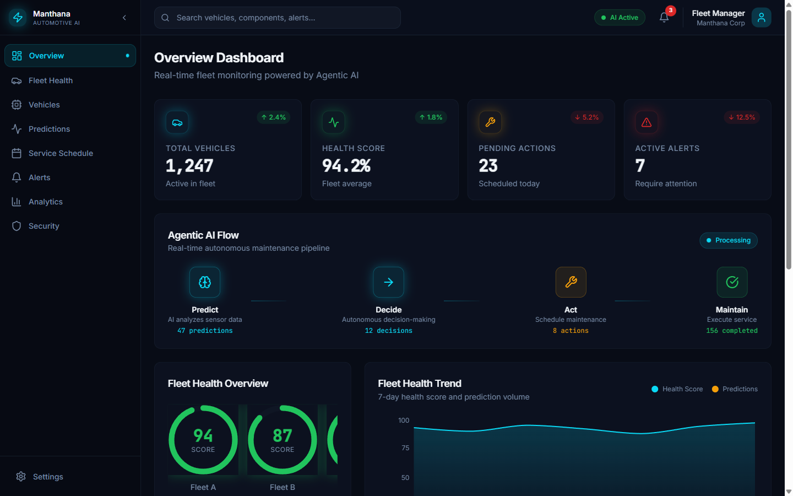
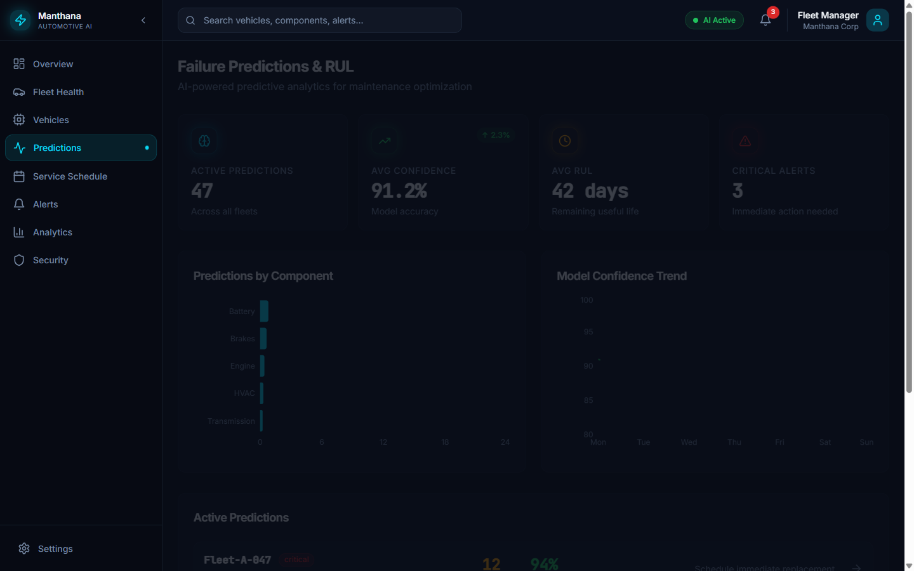

<div align="center">

# Manthana Automotive AI

**An operations dashboard for agentic predictive maintenance across vehicle fleets.**

[](LICENSE)
[](https://react.dev)
[](https://www.typescriptlang.org)
[](https://vite.dev)
[](https://tailwindcss.com)

[Report a bug](https://github.com/Divyakush2006/Manthana-Automotive-AI/issues/new/choose) · [Request a feature](https://github.com/Divyakush2006/Manthana-Automotive-AI/issues/new/choose)



</div>

## Overview

Manthana is the front end of a predictive-maintenance platform for vehicle fleets. It presents the full loop an autonomous maintenance agent runs: **Predict** failures from sensor data, **Decide** what to do, **Act** by scheduling service, and **Maintain** the vehicle. Each stage of that loop has its own workspace in a single dark-themed console.

> [!NOTE]
> This repository contains the user interface only. Every screen is driven by built-in illustrative data, so the dashboard runs with no backend, API keys or database.

## Features

| Area | What it shows |
| --- | --- |
| **Overview** | Fleet KPIs (vehicles, health score, pending actions, alerts), the agentic flow pipeline, per-fleet health gauges, a 7-day health and prediction trend, live alerts and vehicle status |
| **Fleet Health** | Fleet availability, average health score and vehicles in maintenance |
| **Vehicles** | Vehicle inventory and per-vehicle status |
| **Predictions** | Active failure predictions, model confidence and average remaining useful life (RUL) |
| **Service Schedule** | Today's appointments, services in progress and completed work |
| **Alerts** | Active alerts by severity: critical, warning and informational |
| **Analytics** | Maintenance cost trend, failure distribution and fleet utilisation charts |
| **Security** | Security score, active sessions and blocked threats |
| **Settings** | Account plan, API usage and preferences |

The sidebar collapses to an icon rail, and every route is client-side, so navigation is instant.

<p align="center">
  
</p>

## Tech stack

| Layer | Technology |
| --- | --- |
| Framework | [React 18](https://react.dev) with [TypeScript](https://www.typescriptlang.org) |
| Build tool | [Vite 5](https://vite.dev) |
| Styling | [Tailwind CSS](https://tailwindcss.com) and [shadcn/ui](https://ui.shadcn.com) components on [Radix UI](https://www.radix-ui.com) primitives |
| Charts | [Recharts](https://recharts.org) |
| Routing | [React Router 6](https://reactrouter.com) |
| State | [TanStack Query](https://tanstack.com/query) |
| Icons | [Lucide](https://lucide.dev) |

## Getting started

### Prerequisites

- [Node.js](https://nodejs.org) 18 or later, with npm

### Run locally

```bash
git clone https://github.com/Divyakush2006/Manthana-Automotive-AI.git
cd Manthana-Automotive-AI
npm install
npm run dev
```

The app is served at <http://localhost:8080>.

### Scripts

| Command | Description |
| --- | --- |
| `npm run dev` | Start the development server with hot reload |
| `npm run build` | Create a production build in `dist/` |
| `npm run preview` | Serve the production build locally |
| `npm run lint` | Lint the project with ESLint |

## Project structure

```
src/
├── App.tsx                 # Routes and app-wide providers
├── pages/                  # One file per route: Index, FleetHealth, Vehicles,
│                           # Predictions, Schedule, Alerts, Analytics, Security, Settings
├── components/
│   ├── dashboard/          # AgenticFlow, FleetHealthGauge, FleetOverviewChart,
│   │                       # AlertsList, VehicleStatusTable, MetricCard
│   ├── layout/             # DashboardLayout, AppSidebar, TopBar
│   └── ui/                 # shadcn/ui primitives
├── hooks/                  # Responsive and toast hooks
└── lib/                    # Shared utilities
```

## Deployment

`npm run build` outputs a static site to `dist/`. It can be hosted on any static host, for example Cloudflare Pages (build command `npm run build`, output directory `dist`). Because routing is client-side, configure the host to serve `index.html` for unknown paths.

## Contributing

Contributions are welcome. Please read the [contributing guide](https://github.com/Divyakush2006/.github/blob/main/CONTRIBUTING.md) before opening a pull request.

## Security

Please report vulnerabilities privately as described in the [security policy](https://github.com/Divyakush2006/.github/blob/main/SECURITY.md). Do not open a public issue.

## License

Released under the [MIT License](LICENSE).

## Author

**Divyakush Punjabi** · [www.divyakush.com](https://www.divyakush.com) · [GitHub](https://github.com/Divyakush2006) · [LinkedIn](https://linkedin.com/in/divyakush-punjabi)
